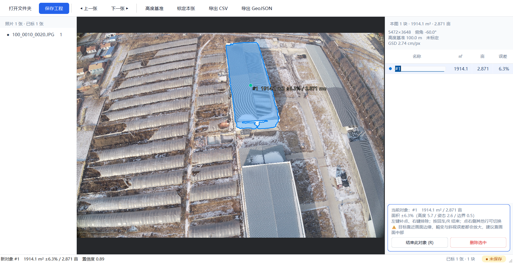
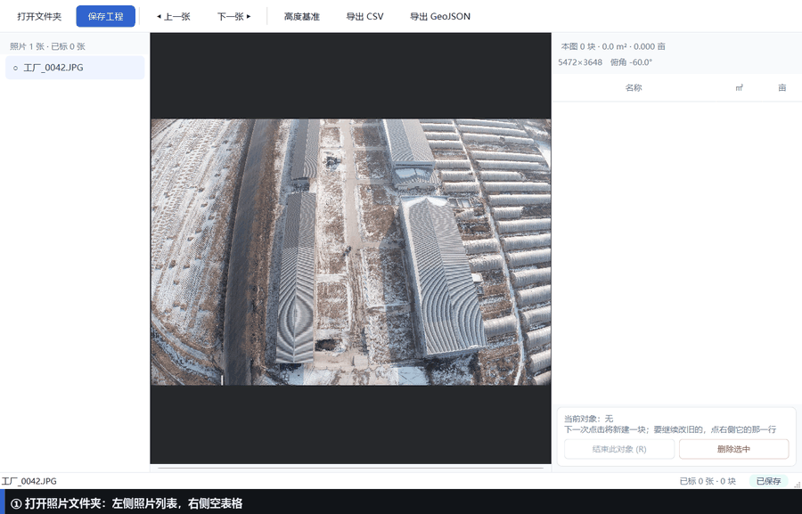
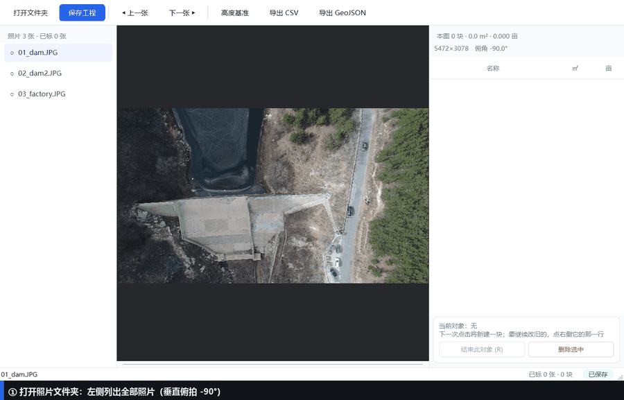
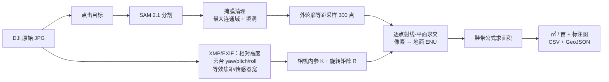

# 单张无人机照片 · 面积量算

**一张 DJI 原图 → 点一下地物 → 直接得出真实面积（㎡ / 亩）。** 不拼图、不做正射、不联网，笔记本本地跑，单张 1~2 秒出结果。

`Python` · `PySide6` · `PyTorch` · `SAM 2` · `OpenCV` · `单像摄影测量`

> 定位：**现场快速估价**（作业量估算、面积核对、外业踏勘）。每块地旁边直接给出 `±x%` 的**不确定度预算**，典型值 3~7%；**不是测绘成果**。
>
> 说明：这个 ± 是**由已知参数推算的精度**（高度/姿态/边界三项合成），不是拿实测真值比出来的统计精度。两者含义不同，下面「精度」一节把口径写清楚了。

---

## 演示

### 界面



*右侧每一行就是一块地：`名称 / ㎡ / 亩 / 误差`。点一下厂房顶 → 1914.1 ㎡ / 2.871 亩 / **±6.3%**；卡片里把 ±6.3% 拆成「高度 5.7 / 姿态 2.6 / 边界 0.5」，能看出这块地的误差到底卡在哪一环。*

### 一、两栋厂房



*点一下 → SAM2 出掩膜 → 直接给面积（1756.5 ㎡ / 2.635 亩）→ 起名回车 → 再点第二栋（1046.6 ㎡），本图合计自动累加到 2803.0 ㎡。*

### 二、两辆汽车（垂直俯拍 -90°）



*同一套流程用在更小的目标上：路面上 4.9 m 长的车，量得 9.6 ㎡ 和 11.3 ㎡。选车是因为**尺寸可以肉眼核对**——任何人都能判断这个数对不对。放大后车身与掩膜贴合得很好。*

---

## 30 秒跑起来

```bash
pip install -r requirements.txt
pip install git+https://github.com/facebookresearch/sam2.git

mkdir -p weights && cd weights
curl -L -O https://dl.fbaipublicfiles.com/segment_anything_2/092824/sam2.1_hiera_small.pt

cd ..
python uav_area/app_gui.py          # Windows 也可双击「启动界面.bat」
```

首次启动加载模型 12-15 秒，之后每张照片编码 1-2 秒（都在后台线程，界面不卡）。

---

## 它解决什么问题

单张照片量面积，难的不是"点一下出轮廓"，而是**把像素换算成米**。

常见做法 `面积 = 像素数 × GSD²` 只在**严格正射**时成立；一旦斜拍，画面上下两侧比例完全不同，直接乘 GSD 能差几十个百分点。这个项目走的是逐点投影：



核心就一条：把像素反投影成方向向量，旋到 ENU，再与水平地面求交。

$$P_{ground} = P_{cam} + t \cdot R\,d_{cam}, \qquad t = \frac{z_{target} - h}{[R\,d_{cam}]_z}$$

其中 $h$ 是相机相对**目标地面**的高度——**这也是整个方法唯一的误差命门**，见下文。

---

## 交互

三栏：左＝照片列表（`●` 已标）；中＝画布；右＝本图地块表 + 当前对象。

| 操作 | 作用 |
|---|---|
| 左键 / 右键 | 加前景点 / 排除点，作用在**当前对象**上；没有当前对象时左键新建一块 |
| 滚轮 / 中键拖动 | 缩放 / 平移（放大到单辆车也能点准） |
| **回车** 或 **R** | 接受名称、结束当前对象 |
| 点右侧某一行 | 把那一块设为当前对象，之后的点都改它 |
| `Ctrl+Z` / `U` | 撤销一个点 |
| `Ctrl+B` | **标定本张**：用画面里一段已知长度反解真实航高 |
| `Esc` | 取消标定取点 |
| `A` / `D` | 上一张 / 下一张 |
| `Delete` | 删除选中地块 |
| `F2` | 改名字 |
| `Ctrl+S` | 保存工程 |

### 草稿 vs 保存

| | 什么时候产生 | 存在哪 | 关软件后 |
|---|---|---|---|
| **草稿** | 点一下目标、识别出面积就自动进表，不用按键 | 内存 | 丢失（关闭前弹窗提醒） |
| **保存** | `Ctrl+S` | 照片文件夹的 `project.json` | 保留，下次打开还在 |

正常流程：**点 → 看面积 → 打字改名 → 回车 → D 下一张**，全部标完按一次 `Ctrl+S`。

---

## 精度：能到多少，卡在哪

面积与高度平方成正比：

$$\frac{\Delta A}{A} \approx 2 \times \frac{\Delta h}{h}$$

| 误差来源 | 量级 | 能不能消掉 |
|---|---|---|
| 内参（FOV 口径） | <1% | 已处理：物理焦距 × 传感器宽，并修正 16:9 裁切（曾带来 9.7% 偏差） |
| 云台姿态 | ~0.1° | 照片自带 |
| 分割边界 | 0.7%（材质单一）~ 3%（边界模糊） | 掩膜清理 + 负点修正 |
| **高度基准 h** | **每 1 m 高差 ≈ 2% 面积** | **单张照片里没有这个信息** |

**为什么照片解决不了 h**：元数据只给 `RelativeAltitude`，那是**相对起飞点**的高度。相机在起飞点上方 100 m，照片知道；目标地块比起飞点低 15 m，照片不知道。深度信息单张照片原理上就没有——要第二个视角才能解出来，那正是"拼正射"要做的事。

**所以本项目的前提是**：目标地块相对平坦、**起飞点就在目标地块边**（高差≈0）。这时 100 m 航高下 1~2 m 高差只带来 2~4% 误差，落在目标区间内。

山区、陡坡、屋顶、堆体等场景不承诺精度——那是 DSM/DEM 或双片交会的活。

**其他边界**：不生成正射、不做空三、不用控制点；不做全图自动普查（一次点一块，因为相邻同作物地块必须人工指定）。

### 每块地旁边的 ± 怎么来的

三项分别求偏导，再按平方和合成（三项近似独立，不能直接相加）：

| 项 | 怎么算 | 示例值 | 说明 |
|---|---|---|---|
| **高度** | `2·σh/h`（纯解析，因为 A∝h²） | 5.7% | 主导项。未标定时 `σh = √((2%·h)² + (2 m)²)`：相对高度误差 2% + 平原地面起伏 2 m |
| **姿态** | 中心差分 `\|A(θ+σ)−A(θ−σ)\|/(2A)`，三个角 RSS | 2.6% | σ 取 pitch 0.5° / roll 0.3° / yaw 1.0°。**yaw 恒为 0**：绕天轴旋转是地面平面内的旋转，不改面积（只改面积在地图上的朝向） |
| **边界** | `σ_px · 周长 / 面积` | 0.5% | 按 1 px 系统性偏差取。对凸多边形这是精确关系（面积对等距偏移的导数就是周长，Steiner 公式），凹形边界下是偏保守的上界 |

`σ_A/A = √(高度² + 姿态² + 边界²)`

只有 `σh` 是"估"出来的（照片里没有误差条这个字段），口径写在 `uav_geo.py: default_sigma_h()`，可在调用处覆盖。其余两项都是从这张照片自己的几何里算出来的，换成任何一张照片、任何一个目标都自动跟着变。

### 已知长度标定：把 ±6.3% 压到 ±2.9%

高度虽然是主导项，但它**能被这张照片自己纠正**——因为画面里量出来的长度同样正比于 h：

$$h_{true} = h_{use} \times \frac{L_{known}}{L_{measured}}$$

注意这个式子里**没有 h_use 的绝对值**：h_use 错 10%，量出的长度也错 10%，比掉了。这就是它比"手填地面高差"可靠的原因。

操作：`Ctrl+B` → 点参照物两端 → 输入实地米数（车长、大棚跨度、球场边线都行）→ 只对当前这张照片生效，写进 `project.json` 的 `calib` 字段。

同一个目标（厂房屋顶 1914.1 ㎡）：

| | 航高 | 面积 | 误差预算 | 组成 |
|---|---|---|---|---|
| 未标定（用照片的相对高度） | 100.0 m | 1914.1 ㎡ | **±6.3%** | 高度 5.7 / 姿态 2.6 / 边界 0.5 |
| 标定后 | 99.97 m | 1914.1 ㎡ | **±2.9%** | 高度 1.4 / 姿态 2.6 / 边界 0.5 |

（这一次的参照长度取自同一套参数，所以航高不变——它验证的是"标定后误差口径确实切换了"。**真实的纠偏能力**见下面验证 D：航高被谎报 10% 时面积错 21%，标定后回到 0.00%。）

---

## 实测数据

6 组真实 DJI 照片（M3T / M3TD / M4TD，20MP，75~130 m 航高，俯角 -32.9° ~ -89.9°）。

| 目标 | 照片 / 俯角 | 结果 | 备注 |
|---|---|---|---|
| 长条厂房 | 工厂 / -60° | 1756.5 ㎡ / 2.635 亩 | 含屋顶，比地面略偏大 |
| 第二栋厂房 | 工厂 / -60° | 1046.6 ㎡ / 1.570 亩 | 同上 |
| 混凝土坝面 | DJI_0018 / -90° | 1890.8 ㎡ / 2.836 亩 | 材质单一，轮廓稳定 |
| 两辆汽车 | DJI_0018 / -90° | 9.6 ㎡ / 11.3 ㎡ | 4.9 m 车长，可肉眼核对 |
| 车长校验（双点） | car_test / -45° | 5.79 m（设定真值 5 m） | 反解等效高度 87.0 m，与元数据差 13.8 m |

最后一行是**故意留的反例**：斜拍 + 目标不在起飞点高度时，元数据高度不可用，误差 16%。它说明"高度基准"才是主要误差源，不是算法。

### 五套自检

| 脚本 | 作用 |
|---|---|
| `check_phase0.py` | 参数解析检查（hfov / fx / GSD）+ 两点量距 |
| `_geom_regress.py` | 几何内核等价性回归：2000 组随机姿态，容差 1e-9 |
| `check_seg_stability.py` | 分割稳定性：同目标多随机种子，看面积离散与掩膜 IoU |
| `check_accuracy.py` | 双片一致性：同一地物在两片投影是否重合（带伪匹配过滤） |
| `check_improve.py` | **误差模型 + 已知长度标定**的有效性（12 项可解析断言，不需要照片、不要 SAM2，3 秒跑完） |

`python check_improve.py` 的实测输出（合成场景 + 真实照片 + 工程数据层）：

| 检查 | 实测 | 理论/期望 |
|---|---|---|
| A 垂直俯拍 20×30 m 的反投影面积 | 600.0000 ㎡ | 600（差 7.6e-16） |
| B 航高 +10% → 面积比 | 1.2100× | 1.21（面积∝h²） |
| C1 误差模型 vs 600 次蒙特卡洛 | 预测 5.66% / 实测 5.70% | 应吻合（一阶近似） |
| C2 边界公式 `P·σ/A` vs 膨胀腐蚀实测 | 0.7333% / 0.7333% | 应相等（凸多边形精确） |
| D1 标定前，航高谎报 10% 的面积误差 | 21.00% | 21%（(1.1)²−1） |
| D2 标定后同一块地的面积误差 | 0.00% | ≈0 |
| D3 标定反推的航高 | 100.0000 m | 100（真值） |
| E1–E5 工程数据层往返 | 面积/误差/CSV 列/GeoJSON 字段 | 全部命中 |

分割稳定性实测：

| 目标 | IoU 中位数 | 常态面积离散(IQR) | 结论 |
|---|---|---|---|
| 坝面（材质单一） | 0.98 | 0.7% | 点哪都一样 |
| 厂房（旁边有同款） | 0.93~0.97 | 2.8% ~ 36% | 会串到隔壁，需右键排除 |

---

## 输出

`Ctrl+S` 只写工程；导出在工具栏。

**CSV**（明细 + 按照片汇总两张表）：

```csv
照片,地块编号,地块名称,面积_m2,面积_亩,误差_%,中心纬度,中心经度,高度基准_m,置信度,提示
DJI_0018.JPG,1,车辆1,9.60,0.0144,5.8,41.00296924,111.97036184,111.50,0.930,
DJI_0018.JPG,2,车辆2,11.30,0.0170,5.8,41.00288015,111.97012508,111.50,0.890,
```

**GeoJSON**（可直接拖进 QGIS / ArcGIS）：

```json
{"type": "Feature",
 "geometry": {"type": "Polygon", "coordinates": [[[111.97045, 41.00299], "..."]]},
 "properties": {"photo": "DJI_0018.JPG", "fid": 1, "name": "车辆1",
                "area_m2": 9.6, "area_mu": 0.0144, "error_pct": 5.8,
                "height_m": 111.5, "score": 0.93}}
```

另外写出标注图 `result_*.jpg`（多边形 + 编号 + 面积 + ±%）和每块地的掩膜 PNG。

**工程文件** `project.json`（写在照片文件夹里，只存参数与轮廓点，不存图片）：

```json
{"version": 2,
 "defaults": {"target_z": 0.0, "use_lrf": false},
 "images": {"DJI_0018.JPG": {
   "meta": {"rel_alt": 111.5, "gimbal_pitch": -90.0, "hfov": 73.74, "...": "..."},
   "calib": {"h": 99.97, "ref_len_m": 11.05, "p1": [4400, 900], "p2": [4700, 900]},
   "fields": [{"fid": 1, "name": "车辆1", "area_m2": 9.6, "err_rel": 0.029,
               "contour_px": [[4320.1, 650.2], "..."]}]}}}
```

只存轮廓、不存掩膜的好处：改高度基准或标定后能**一键全量重算**面积与误差，不用重新标注。`calib` 是**每张照片独立**的（同一地点不同航高就得各标各的），`defaults` 才作用于全工程。

---

## 目录

```
项目根目录/
├─ README.md
├─ requirements.txt
├─ LICENSE
├─ 启动界面.bat / 启动测量.bat     # 双击启动（桌面版 / 命令行版）
├─ docs/                           # 演示 GIF
├─ weights/                        # SAM2 权重（176MB，不进仓库）
└─ uav_area/
   ├─ app_gui.py                   # 桌面版界面（PySide6，三栏）
   ├─ project_store.py             # 工程数据层：project.json / CSV / GeoJSON（无 Qt 依赖）
   ├─ uav_geo.py                   # 几何内核：读参数 / 相机模型 / 像素→地面 / 面积
   ├─ measure_area.py              # 命令行版：点击分割 + 面积 + 落盘
   ├─ run_measure.py               # 命令行版的启动包装
   ├─ check_phase0.py              # 参数自检
   ├─ check_accuracy.py            # 双片一致性
   ├─ check_seg_stability.py       # 分割稳定性
   ├─ check_improve.py             # 误差预算 + 标定的有效性验证
   └─ _geom_regress.py             # 几何内核等价回归
```

分四层，换前端时前两层不用动：`uav_geo`（几何，不碰 UI）→ `project_store`（数据，不碰 Qt）→ `app_gui` / `measure_area`（两种界面）。

---

## 环境

Python 3.10，Windows 11 开发，4 GB 显存可跑。

| 依赖 | 实测版本 |
|---|---|
| torch | 2.5.1+cu118（CPU 也能跑，只是慢） |
| sam2 | 官方 main 分支 |
| opencv-python | 4.11.0 |
| PySide6 | 6.9.1 |
| Pillow | 12.2.0 |
| numpy | 1.26.4 |

不用装 exiftool：Pillow 就能读 XMP / EXIF / GPS（含老机型只写 EXIF GPS 的情况）。

---

## 踩过的坑

做这个项目真正花时间的地方，都记下来当经验：

1. **16:9 裁切画幅不能用等效焦距反推 FOV**。用 `FocalLengthIn35mmFilm` 反算得到 69° 水平 FOV，实际是 73.74°——差 9.7% 面积。改用"物理焦距 × 传感器宽"才对。
2. **Windows 上必须先 `import cv2` 再加载 torch**，否则 `DLL load failed while importing cv2`。导入顺序写死在 `measure_area.py` 顶部。
3. **不要用 QThread 跑 SAM2 推理**。同一段代码放 `threading.Thread` 里 0.4 s 返回，放 `QThread` 就永久挂住。最后用「线程 + 双队列 + QTimer 轮询」。
4. **QTableWidget 的委托会吃掉回车**：`QLineEdit.returnPressed` 在表格编辑器里根本不触发（名字改成功但"结束对象"没执行）。改用事件过滤器抢在委托前面接住回车。
5. **几何内核改动必须过回归**。`_geom_regress.py` 拿新旧两套实现比 2000 组随机姿态，差 >1e-9 就说明改坏了。
6. **"重算面积"必须先把手上的草稿同步进工程**。第一次写标定功能时，`recompute()` 读的是 `project.json` 里的地块，而新点的地块还只在内存草稿里 —— 结果是"重算 0 张"并顺手把草稿覆盖成空。所有会触发重算的入口（改高度基准 / 标定 / 清除标定）都先 `_sync_doc()`。这个 bug 是自检截图里"地块数 0"暴露出来的，不是点出来的。
7. **引擎和界面必须共用同一套相机参数优先级**（标定 > LRF > 相对高度 − 高差）。两边各写一份 `Camera(...)` 时，界面显示 100 m、实际按 110 m 算面积，这种错不会报错，只会默默偏 20%。现在统一走 `_make_cam` 一个入口。

---

## 路线图

- [x] 单张点击量算 + 斜拍支持
- [x] SAM2 分割 + 掩膜清理 + 负点修正
- [x] 桌面版（三栏、逐张、续标、多地块）
- [x] CSV / GeoJSON 导出
- [x] 用画面内已知长度反解高度（`Ctrl+B`，写进 project.json，逐张生效）
- [x] 面积不确定度区间（高度 / 姿态 / 边界三项合成，随参数自动变）
- [ ] 批量把标定结果传播到同一航线的其他照片（同高度起降时能省掉逐张点参照物）
- [ ] 打包 exe（PyInstaller）
- [ ] 用实测真值（RTK 实测面积）统计一次真实精度，替换现在的预算推算

---

## 致谢

- **SAM 2**（Meta AI，Apache-2.0）—— 分割模型。
- 早期几何函数参考过 [UAVGeoMeasure](https://github.com/Thamkench/UAVGeoMeasure)。该仓库**没有 LICENSE 文件**，按版权默认属"保留所有权利"，因此不能沿用；现已按公开的摄影测量公式重写为独立实现（`_geom_regress.py` 验证与旧版数值等价），仅保留思路上的致谢。
- 演示照片来自公开教程样例。

## License

MIT，见 [LICENSE](LICENSE)。
